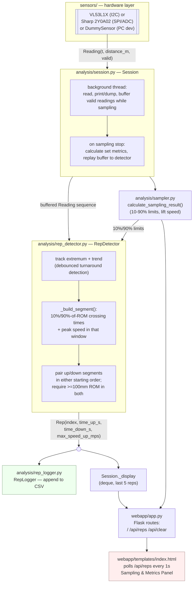

# Barspeed — Architecture

Raspberry Pi barbell velocity tracker. A distance sensor feeds a
layered pipeline — calibration → rep detection → logging → web UI —
built so the sensor can be swapped without touching anything above it.

## Design principle

Everything above the sensor layer depends on one contract:

```python
Reading(t: float, distance_m: float, valid: bool = True)
```

`t` is seconds on a monotonic clock, relative to that sensor's own
`open()` call. `analysis/`, `webapp/`, and the CLI never import a
concrete sensor class — only `sensors.DistanceSensor` and
`sensors.Reading`. Swapping sensors (VL53L1X ↔ Sharp ↔ dummy) means
changing `--sensor` on the command line, nothing else.

## Data flow



## Layers

| # | Layer | Location | Responsibility |
|---|-------|----------|-----------------|
| 1 | Acquisition | `sensors/` | Only layer that touches hardware (I2C/SPI). Emits `Reading`. |
| 2 | Calibration | `sensors/calibration.py` | Sharp-only: raw voltage → distance in meters. VL53L1X needs none (direct mm output). |
| 3 | Kinematics | *(not a separate module)* | Distance+time → velocity. Currently folded into rep detection as a simple point-to-point max within the 10–90% window — see [Known Issues](KNOWN_ISSUES.md#no-dedicated-kinematics-module). |
| 4 | Rep/set analysis | `analysis/` | Turnaround detection, rep timing, peak velocity, set sampling (10-90% range & lift speed), per-set CSV logging. |
| 5 | Web UI | `webapp/` | Flask app: polls session state, displays last 5 reps, set sampling metrics & clear/start/stop button. |

## Module map

```
Barspeed/
    main.py                    # entry point: argparse → create_sensor/create_app → app.run
    main_rep_detector.py       # standalone sensor stream → RepDetector; CSV readings on stdout
    tof_probe.py                # standalone VL53L1X hardware verification (no Flask/analysis)
    adcprobe.py                 # standalone Sharp/MCP3202 hardware verification (no Flask/analysis)

    sensors/
        __init__.py              # re-exports DistanceSensor, Reading, create_sensor
        base.py                  # DistanceSensor ABC + Reading dataclass — the layer-1/2→3 contract
        vl53l1x_sensor.py         # VL53L1X ToF (I2C) — current primary sensor
        sharp2y0a02.py            # Sharp 2Y0A02 via MCP3202/ADCDACPi (SPI) — legacy/fallback
        dummy.py                 # PC dev stand-in, no hardware needed
        calibration.py            # Sharp-only: voltage → distance (nominal datasheet curve)
        factory.py               # create_sensor(args) -> DistanceSensor — the only branch point

    analysis/
        __init__.py
        constants.py              # segment fractions, 50mm turnaround and 100mm rep ROM thresholds
        rep_detector.py           # Segment, Rep, RepDetector — turnaround, filtering, and rep pairing
        rep_logger.py             # RepLogger — CSV output, per-set indexing
        sampler.py                # SamplingResult, calculate_sampling_result — 10-90% range & lift speed calculation
        session.py                # Session — sensor thread, raw dump, sampling buffer, detector replay, logger

    webapp/
        __init__.py
        app.py                   # create_app(args) -> Flask app; routes: /, /api/reps, /api/clear
        templates/
            index.html            # polls /api/reps every 1s, set sampling panel & toggle button

    pyproject.toml
    reps_log.csv                # runtime output, not checked in
    calibration.json             # Sharp calibration data (currently unused — see calibration.py)
```

## Detection and logging behavior

The web app's acquisition thread continuously reads the sensor. `-p` prints
raw readings and `-d/--dump` writes them to CSV whether or not a set is being
sampled; neither option runs rep detection. The UI's sampling button toggles
collection of valid readings. When sampling stops (or reaches the five-minute
timeout), `Session` calculates set metrics and replays the buffered readings
through a fresh `RepDetector`; completed reps are then logged and displayed.
Consequently, a raw `-p` output or dump is not itself a record of which
readings were included in a sampled set.

The detector ignores invalid readings, confirms turnarounds using a 50 mm
minimum reversal and a two-sample debounce, and requires at least 100 mm of
range in both the up and down segments to count a rep. It can pair the first
complete cycle regardless of whether sampling begins during the up or down
phase. If sampling begins mid-stroke, a short partial segment is rejected
without discarding a qualifying full-range segment that can pair with the
next opposite-direction segment.

`main_rep_detector.py` is an alternative, standalone sensor runner. It feeds
readings directly to `RepDetector`, writes raw location CSV rows to stdout,
and writes segment and rep summaries to stderr. Unlike the web app, it does
not wait for the UI sampling button.

## CLI (`main.py`)

```
python3 main.py --platform {rpi,pc} --i2c-bus 1 --i2c-address 0x29
                 --log-file reps.csv --json-log-file reps.json
                 --dump readings.csv --host 0.0.0.0 --port 5000
                 --print --rep --verbose-web
```

- `--platform pc` → `DummySensor` (sine-wave stand-in, zero hardware deps).
- `--platform rpi` (default) → VL53L1X sensor.
- `--print` prints raw sensor readings; `--dump` writes all readings to CSV.
- `--rep` prints segment details when a sampled buffer is processed.
- Must run as `python3 main.py` from the project root — `sensors`/`analysis`/`webapp`
  are sibling packages and need the project root on `sys.path`.

## Threading & Sampling model

`Session` owns one background daemon thread (`_run`) that loops
`sensor.read()` → `detector.update()` continuously. When sampling is active
(triggered via the web server button), readings are collected into a sampling buffer
until the button is pressed again or 5 minutes (300 seconds) pass. Once sampling ends,
`calculate_sampling_result()` computes highest/lowest distances, 10% & 90% limits, 10-90 travel time,
and lift speed.

The sensor acquisition thread is separate from Flask's request threads, but
rep processing is batch-based: stopping sampling runs set analysis and detector
replay in the request handling path while holding the session lock. Completed
`Rep`s are appended to the CSV log and added to the display buffer. Flask reads
`_display` and `_sampling_result` through `latest_reps()` and
`get_sampling_status()` under that same lock.

## See also

- [MODULES.md](MODULES.md) — per-file reference: public interfaces, invariants, sharp edges.
- [KNOWN_ISSUES.md](KNOWN_ISSUES.md) — open TODOs, resolved gotchas, and decisions worth remembering.
